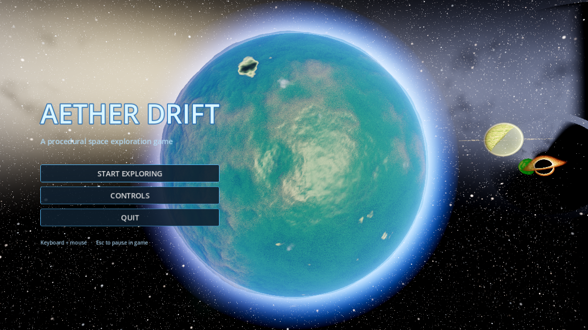

# AETHER DRIFT — a No Man's Sky–style space exploration game (Godot 4.7.2)

> **Как запустить готовую сборку / How to run the ready-made build:** см. / see [HOW_TO_PLAY.md](../../HOW_TO_PLAY.md) в корне репозитория / in the repository root. Если ниже упоминаются другие файлы запуска — их в этом репозитории нет / if other launch files are mentioned below, they are not part of this repository.

A seamless, fully procedural space exploration game: fly between planets in a star system, descend through the
atmosphere, land, step out and explore on foot, mine crystals, fly into a **black hole**, warp to other stars through
the **galaxy map**. Everything — galaxy, systems, planets, terrain, flora placement — comes from seeds, so a planet
looks identical on every visit. All custom 3D models were modelled **through the Blender MCP** (port 9879).



## Run it

**Ready-made build:** `build/AetherDrift.exe` (Windows x64, single file, no installation). Rebuild with
`Godot_v4.7.2-stable_win64_console.exe --headless --path . --export-release "Windows Desktop" build/AetherDrift.exe`
(preset in `export_presets.cfg`).

Or run from the project:

Open the folder with Godot **4.7.2** and press Play (main scene: `scenes/main.tscn`), or from a shell:

```
Godot_v4.7.2-stable_win64.exe --path "<local-path> 5.5 Effort Test\3. High Effort"
```

No extra installation. (If you copy the project somewhere fresh, run it once with `--import` or open the editor once
so Godot registers the `.glb` models and script classes.)

## Controls (keyboard + mouse; also in the in-game *Controls* screen)

| | |
|---|---|
| **Ship** | Mouse pitch/yaw · `Q`/`E` roll · `W`/`S` throttle up/down · `X` cut throttle · `Ctrl` brake · `A`/`D` strafe · `R`/`F` thrust up/down · `Shift` boost · `Space` pulse drive (open space) / take off when landed · `V` cockpit/chase camera |
| **On foot** | `WASD` walk · `Shift` sprint · `Space` jump (hold in the air = jetpack) · mouse look · **LMB** mining laser · `Q` scanner · `R` use power cell · `E` interact / enter ship · `V` first/third person |
| **General** | `M` galaxy map (select a star, `Enter` / double-click to warp; `Tab` = live system map) · `Esc` pause · `F3` FPS |

**Landing**: fly low and slow, hover down with `F` (gear deploys automatically below ~120 m). Touch down at < 14 m/s
vertical, < 50 m/s sideways and a roughly level ship, otherwise you take crash damage. You cannot land on liquid or
steep slopes. `Space` on the ground lifts off again. You start parked on the landing pad of the lush planet **Verdance**.

## What was built

### Galaxy, systems, planets
* **Galaxy** (`scripts/data/galaxy.gd`): 640 named stars on a four-arm spiral with a bulge; a sky shader draws the
  matching galactic band, nebulae and 5 layers of stars. The **galaxy map** (`M`) shows all stars (class colours,
  black-hole markers, planet list of the selected star); a second tab is a live **system map** with moving orbits.
* **Star systems** (`system_gen.gd`): star class O–M (colour, size, brightness), 4–6 planets plus moons / gas giants,
  generated from the star's seed. Home system **Solenne** (class G) is hand-authored with **9 bodies**: Pyrrhus
  (volcanic), Kharos (desert), Verdance (lush) + moon Lumen (barren), Miasma (toxic), Glacia (frozen), the ringed gas
  giant Titanus with moons Cinder (barren) and Hush (frozen) — **8 landable bodies, 6 distinct biomes**, plus a black
  hole. Orbits and spin are real-time (days last 12–20 minutes, so you *see* sunsets; the system map shows orbits move).
  Second systems: warp to any star on the map, or go through the black hole to **Kharon** (blue-white class A star,
  different planets).
* **Planets** are cube-sphere worlds (radius 1.9–6 km) walked on with radial gravity. Terrain is displaced **on the
  GPU** (`shaders/terrain.gdshader`) in a quadtree-LOD of identical 49×49 patches (up to 9 levels, ~0.6 m vertex
  spacing at your feet, skirts hide LOD cracks). The same integer-hash gradient noise runs in GDScript
  (`terrain_params.gd`), so physics, landing and prop placement agree with what you see.
* **Biomes** (`biomes.gd`) differ in terrain shape (rolling hills + oceans, terraced mesas + dunes, ridged glaciers,
  caldera/lava rivers, fungal plains, cratered moons), palette, sky/fog/atmosphere colour, clouds, weather
  (rain, dust storms, snow, ash, floating spores), gravity (3–13 m/s²), temperature/hazard drain, liquids (water /
  lava / toxic sludge), flora and rock props, fauna and resource types.
* **Day/night**: the sun moves because planets spin; sky, fog, ambient light and sun colour follow the sun elevation,
  planets cast eclipse shadows, atmospheres glow from space (ray-marched scattering shell) and blend into the sky by
  altitude. Clouds drift on a shell above the terrain.
* Procedural **flora/rocks/resources** stream in around you on a cube-sphere cell grid (worker threads → MultiMesh
  with distance fade) with simple circle colliders for trees and rocks; each planet has a flattened **outpost +
  landing pad**, a monolith, a beacon and a supply cache. Fauna (hoppers, floaters) wanders near you.

### Ship, landing, on foot (no loading screens)
* Arcade flight model: thrust/throttle, boost (950 m/s), **pulse drive** (up to 14 km/s, auto-slows and drops out
  near bodies), roll auto-levelling in atmosphere, chase + cockpit cameras, FOV/shake with speed.
* **Atmospheric entry**: heat shell, screen heat vignette, shake and speed limiting; landing gear animation, soft/hard
  landing detection with hull/shield damage; gas giants crush the ship; the star burns it.
* **Floating origin + frame carry** (`universe.gd`): bodies keep double-precision universe positions; the render frame
  is re-centred on the player (rebase at 1.5 km), and the ship is dragged by the body it is closest to so planets never
  slide under you. A parked ship / the astronaut live in the planet's local frame. No jitter at 400 km system scale,
  reversed-Z with a 4,000 km far plane.
* **On foot**: walk, sprint, jump, jetpack, swimming/wading, hazard protection (heat/cold/toxin/vacuum), power cells,
  multitool **mining laser** (hold LMB on glowing crystals/ore), **scanner** pulse that marks resources and points of
  interest on the HUD, interactables (monolith, beacon, supply cache), enter/exit the ship at will.

### The black hole — design and reasoning
There is one in the home system (**Eventide**, ~600 km from the star) and in ~9 % of other systems.
* **Visuals** (`shaders/black_hole.gdshader`): a real ray-marched Schwarzschild lens — light is bent with
  `a = −1.5·h²·x/r⁵`, the screen is re-sampled along the bent ray, so the starfield, planets and the star are lensed;
  dark event horizon and photon ring, turbulent accretion disc with Doppler beaming and the characteristic "second image"
  of the disc above/below the shadow. A faded weak-field deflection removes any seam at the edge of the march volume.
* **Mechanics** (`black_hole.gd`, `ship.gd`): gravity pull `a = K/r²` begins to be felt at **400 km** (HUD:
  *Gravitational anomaly*, rumble audio, time-dilation readout, mild shake). Inside **220 km** *tidal shear* disables
  the pulse drive and hyperdrive. Your engines can still win until the **point of no return at 60 km**, where the pull
  (≈230 m/s²) exceeds your boost acceleration; the HUD turns red and says so. Black-hole gravity is tracked as a separate
  velocity (`vg`) so the arcade velocity controller cannot silently cancel it — you really have to fly away.
  Crossing the **event horizon (1.15 rₛ)** starts a spaghettification / white-out transition (stretching streaks,
  radial blur, fade) and you emerge **~7,000 ly closer to the galactic centre**, in the system of Kharon (home → Kharon;
  other black holes lead to the star nearest the point 7,000 ly toward the core, like No Man's Sky), 230 km from that
  system's own black hole, drifting away so you can explore or fall back in.
  Reasoning: a smooth, readable escalation (see → feel → warned → committed) gives players agency until the point of
  no return, and the destination is fixed so the black hole is a reliable "fast travel / story gate".

### Models (all made through Blender MCP, `tools/blender/*.py`, `high_effort.blend`, `assets/models/*.glb`)
Ship (hull, canopy, wings, engines, retractable gear, nav lights), cockpit interior, astronaut (articulated parts),
multitool, 3 trees, bush, grass, flowers, cactus, dead tree, 3 rocks, rock spire, rock arch, ice crystals, snow pine,
obsidian spikes, lava vent, giant mushroom, spore bulb, tentacle plant, resource crystal, ore node, landing pad,
outpost (dome, modules, tower, solar panels), monolith, beacon, crate, solar array, 2 creatures — **34 models**, built with a small
procedural modelling library (`tools/blender/blib.py`) and exported as `.glb`. Nothing was downloaded; no asset
integrations were used.

### Interface
Main menu with a live planet backdrop, pause menu, controls screen, HUD (location, gravity/temperature, local time,
hull/shield/throttle or health/protection/jetpack bars, speed, altitude, context hints, message banner, world markers
for planets/star/black hole/ship/outpost/scanned resources, black-hole warnings, heat/warp/blackhole screen FX), galaxy
and system maps, procedural audio (engine hum, wind, black-hole rumble; no audio files).

## Project layout
```
scenes/main.tscn           entry scene (script: scripts/main.gd)
scripts/data/              seeds → galaxy, star systems, biomes, planet data
scripts/world/             universe (floating origin), planet body, terrain LOD, props, fauna, star, black hole, weather
scripts/actors/            ship, astronaut
scripts/ui/                HUD, menus, galaxy map
scripts/core/              terrain noise mirror (CPU), asset loader, audio
scripts/dev/               dev harness + scripted playthrough tests
shaders/                   terrain, atmosphere, clouds, liquid, sky, star, corona, black hole, gas giant, rings, dust, overlay
assets/models/             .glb models exported from Blender
tools/blender/             the Blender (bpy) scripts that built every model
docs/screenshots/          screenshots
```

## Testing
`scenes/main.tscn` can run scripted playthroughs: `godot --path . -- auto:<name>` with `start`, `foot`, `takeoff`,
`land`, `entry`, `space`, `bh`, `warp`, `mine`, `ui`, `perf`, `menu`; they drive the real game through the same code path
as keyboard input and save screenshots into `.shots/`. All of these ran without script errors; the full chain *start →
take off → fly → atmosphere entry → land → exit ship → walk / mine → re-enter → take off → black hole → new system*
and the *galaxy map → hyperdrive warp* chain were exercised. Frame rate while flying low over a lush planet: 110–180 FPS
at 1152×648 on an RTX 5070.

## Known limitations / decisions
* Planets are small (2–6 km radius) so a full circumnavigation takes ~20 minutes on foot; the star/planet distances are
  likewise scaled down (system radius ≈ 600 km) so travel is fun rather than realistic. Orbits are slow (hours) but
  visible on the system map.
* Terrain has no mesh colliders: ground height comes from the shared noise function. Trees/rocks use circle colliders;
  structures only the central dome. The ship does not collide with props or the outpost buildings.
* One light source (the star); no real-time GI. Planet-night is lit by a faint ambient colour.
* Creatures are simple wanderers (procedural leg/tentacle animation), there are no hostile fauna or inventory screen.
* Audio is synthesised on the fly (no samples), so it is functional rather than beautiful.
* Decisions made without asking: game title "Aether Drift"; GDScript; arcade (not Newtonian) flight; the black hole
  destination is fixed per system.
