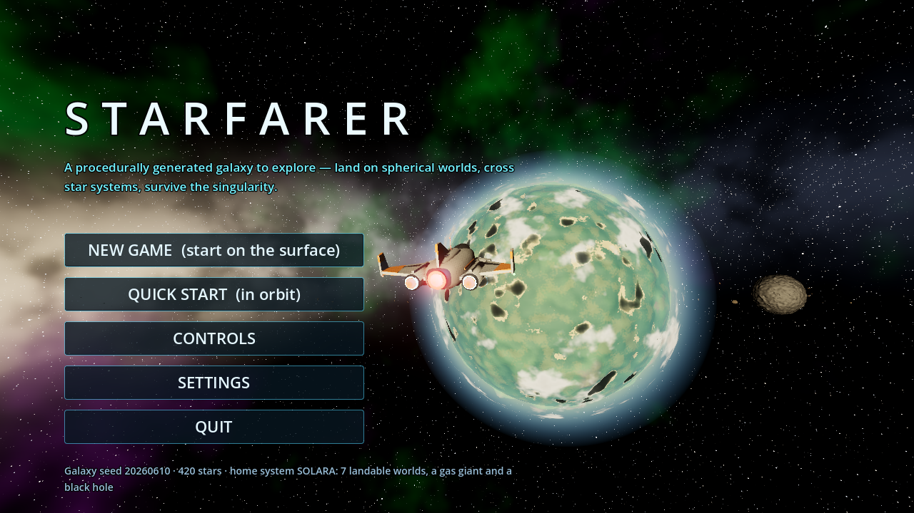

# STARFARER — a No Man's Sky–style space exploration game (Godot 4.7.2)

> **Как запустить готовую сборку / How to run the ready-made build:** см. / see [HOW_TO_PLAY.md](../../HOW_TO_PLAY.md) в корне репозитория / in the repository root. Если ниже упоминаются другие файлы запуска — их в этом репозитории нет / if other launch files are mentioned below, they are not part of this repository.

Fly between planets, drop through an atmosphere, land, step out, walk and jetpack across a spherical world, climb back in, take off,
pulse across a star system, open the galaxy map, hyperjump to another star — or dive into the black hole.
Everything is procedural (seeded) and runs without loading screens. **Every custom 3D model was made in Blender through the Blender MCP**
(port 9880, file `xhigh_effort.blend`), exported as `.glb` and used in the game.



## Run it

* **Ready-made Windows build: `build/Starfarer.exe`** (double-click; single file, the data is embedded, no installation, no Godot needed). It opens a 1600×900 window.
  Rebuild with: `Godot_v4.7.2-stable_win64_console.exe --headless --path . --export-release "Windows Desktop" build/Starfarer.exe` (preset in `export_presets.cfg`, uses the installed 4.7.2 export templates).
* Open the folder in **Godot 4.7.2** and press *Play* (main scene `res://scenes/main.tscn` is set), or run
  `Godot_v4.7.2-stable_win64.exe --path "<this folder>"`.
* GDScript only, Forward+ renderer, no extra installation. The `.godot/` import cache is included, so the first start is immediate.
* Keyboard + mouse. A Vulkan GPU of roughly GTX 1660 / RX 580 class or better is recommended (terrain is displaced on the GPU and the black hole is ray-marched per pixel).
  Measured here on an RTX 5070 (shared with other jobs): ~7 ms/frame average while sprinting across streaming terrain, p99 15 ms.

## Controls (also in-game: **F1**, and on the main/pause menu)

| Spaceship | |
|---|---|
| Mouse | pitch / yaw |
| W / S | throttle up / down (persistent) |
| A / D | strafe |
| Q / E | roll |
| Shift | boost (afterburner) |
| Space (hold) | **pulse drive** (interplanetary cruise, space only; it auto-limits near gravity wells) |
| Ctrl | air-brake · X cut throttle |
| **L** | **landing mode**: gear down, auto-level, automatic gentle descent. Space = lift, Ctrl = lower, WASD = adjust |
| F | exit the ship (when landed) |
| T / Y | next target / clear target (targets set the reference frame and show ETA) |
| M | **galaxy map** (select a star, Enter = hyperjump) |
| V | chase / cockpit camera · N time warp ×60 in deep space · G headlamps |

| On foot | |
|---|---|
| Mouse, W A S D | look, walk · Shift sprint |
| Space | jump, hold in the air for the **jetpack** |
| LMB (hold) | mining beam — collect resources from glowing crystal deposits |
| Q | scanner pulse (reveals deposits and points of interest) |
| E | board the ship (near it) / use outposts, monoliths, wrecks, towers |
| R | recharge hazard protection (consumes a mined resource) · I inventory · V first/third person |
| Esc pause · F1 controls · H hide HUD · F12 screenshot (saved to `user://`) |

## What was built

### Galaxy and star systems
* **Galaxy**: 420 stars on four logarithmic spiral arms plus a bulge (`scripts/core/galaxy.gd`, seed `20260610`). Each star has a class (O…M),
  colour, size, name and a seed that fully determines its system. The **galaxy map** is a 3D, rotatable/zoomable view with ~5,000 dust points for the arms, the glowing
  core, visited marks, black-hole systems and their link lines, distances in light years and a system preview (bodies, landable count, biomes).
* **Home system "Solara"** (G star, hand-composed for guaranteed variety): **Ember** (volcanic), **Dune** (arid), **Verdant** (lush, start planet) with the moon **Pale** (barren),
  the ringed gas giant **Goliath** with the moon **Prismara** (exotic), **Mire** (toxic), **Frost** (frozen) — 8 bodies, **7 landable, 7 distinct biomes** — plus an asteroid belt,
  an orbital station above Verdant and a black hole. Planets orbit the star and moons orbit planets (analytic orbits), all rotate, with axial tilt.
* **Second system and beyond**: every other star generates its own system from its seed (star class decides colour/size/luminosity and biome mix; 5–8 bodies,
  ≥4 landable). Reach them through the galaxy map hyperdrive or the black hole (e.g. the black hole in Solara leads to *Nena*, a K-class system 6,499 ly toward the core).
* **Procedural consistency**: planet shape, colours, flora placement, resource deposits, points of interest and even wildlife colours are pure functions of the planet seed
  (cell-hashed), so a planet is identical on every visit. The sky (Milky Way band orientation, nebulae colours) depends on the star's place in the galaxy.

### Planets (spherical, walkable, clearly different)
* Cube-sphere quadtree terrain whose **heights are evaluated in the vertex shader** (`shaders/terrain.gdshader`): no mesh generation on the CPU, no LOD hitches,
  ~30 m finest chunks, skirts hide LOD cracks. The same noise exists as GDScript (`scripts/core/tnoise.gd`) with a bit-exact integer hash;
  `tests/parity_test.gd` measures the CPU-vs-GPU height difference (**≤ 1.5 cm** over all feature types), which is what makes analytic collisions line up with the rendered ground.
* Gravity points to the planet centre and "up" follows the surface; the astronaut and the ship walk/fly in the planet's *rotating local frame*, so the day/night cycle, the planet's
  orbital motion and the horizon curvature just work.
* Biome = terrain shape + palette + atmosphere + liquids + flora + hazards + weather + gravity:

| Biome | Terrain | Sky / atmosphere | Life / props | Hazard & weather |
|---|---|---|---|---|
| Lush (Verdant) | rolling hills, mountains, lakes | blue Rayleigh sky, white clouds | broad & umbrella trees, bushes, glow-flowers, grass | none · rain showers |
| Arid (Dune) | dunes, terraced mesas | butterscotch sky | cacti, dead trees, hoodoos, rock arches | heat 58 °C · dust storms |
| Frozen (Frost) | snow plains, ice ridges, glossy ice | pale haze | pines, ice spires, crystals | cold −62 °C · snow |
| Volcanic (Ember) | jagged ridges, calderas, **lava lakes + glowing veins** | red-brown ash sky | lava spikes, vents | heat 96 °C · ash, lava damage |
| Toxic (Mire) | swamp pools of **acid** | green-yellow haze | giant mushrooms, spore pods, coral towers | toxic air · spores |
| Barren moon (Pale) | craters | none (vacuum, black sky) | boulders, crystals | cold · no weather |
| Exotic (Prismara) | crystalline terraces, glowing veins | violet-pink | crystal clusters, corals, umbrella trees | radiation · glowing spores |

  Low gravity on moons (Pale 3 m/s²), ~9–10 on the big worlds. Day length 15–28 minutes. Day/night with dusk colours, stars at night, **headlamps** (astronaut + ship) switch on in the dark.
* **Atmosphere**: single-scattering Rayleigh+Mie shader on a shell, drawn from space and from inside (same integral); fog, ambient and the reflection sky follow it,
  sunsets redden the light. **Clouds** layer, **water / lava / acid** spheres (depth-based colour, foam, refraction), **weather particles**, procedurally animated **wildlife**
  (striders that flee, hovering floaters, circling flyers).

### Ship, landing and on-foot gameplay
* **Flight model** (`scripts/actors/ship.gd`): throttle, strafe, roll, boost, **pulse drive** (up to 24 km/s; the allowed speed is limited to 85 % of the distance to the nearest surface, so
  you arrive instead of crashing), flight-assist, a reference frame that follows the target/nearest body, chase and cockpit camera.
* **Seamless space → atmosphere → landing → take-off**: crossing a planet's frame altitude switches the ship from the star-system frame to the planet's rotating frame
  *conserving position and absolute velocity* — no loading, no pop. Entry shows a plasma sheath, heat vignette, sparks, shake and wind roar. Landing mode extends the gear
  (animated Blender gear legs), levels the ship, descends automatically and detects touchdown (speed, tilt, slope); hard impacts damage the shield/hull, never kill you.
* **On foot**: walk, sprint, jump, jetpack (fuel), swimming, slope limits, prop collisions, procedural limb animation, third/first person, mining beam, scanner, resources & inventory,
  hazard protection / health / fuel meters, supply terminals at outposts, a radio tower that reveals the map, monoliths and wrecks (salvage).
* **Numerical precision**: render origin = the player/ship *every frame*; absolute positions are 64-bit doubles (`scripts/core/dv.gd`), planets are placed from double-precision orbits
  and subtracted before the float cast. Standing on a planet moving at 265 m/s the camera's frame-to-frame second difference is **0.2 mm** (`tests` scenario `jitter`).
  No Godot physics engine is used for terrain (analytic collision), so there is no big-world physics breakage. Near/far planes adapt (0.1 m … 1.6e6 m) with a reversed-Z depth buffer.

### Black hole (design + reasoning)
Inspired by No Man's Sky's Atlas black holes: fixed objects that fling you ~7,000 ly toward the galactic centre.
* **Visuals** (`shaders/blackhole.gdshader`): every pixel integrates a light ray through Schwarzschild spacetime (photon acceleration `a = −1.5·h²·r/|r|⁵`, units of the
  Schwarzschild radius). Rays that fall inside r < 1 are black (event-horizon shadow, ~2.6 Rs apparent), rays crossing the disc plane pick up **accretion-disc emission with Doppler
  beaming**, a **photon ring** appears at b ≈ 2.6 Rs, and escaping rays sample the already rendered sky/planets at the *deflected* direction ⇒ real gravitational lensing,
  including the lensed second image of the disc above and below the shadow. Plus a screen-space distortion/chromatic-aberration/red-shift overlay that grows as you approach.
* **Mechanics** (`scripts/world/black_hole.gd`, `world.gd`): pull `a(r) = 3.6·10⁹ / r²` m/s² (Rs = 900 m).
  * < 70 km: *"Gravitational anomaly"* warning (HUD panel, audio). < 55 km: pull > 1 m/s², **pulse drive offline** (locked inside 90 km), rumble + camera shake.
  * < 13 km: *"Escape requires BOOST"* — normal thrust (130 m/s²) can no longer win; boost (370 m/s²) still can.
  * **Point of no return at ~3.1 km** (pull exceeds boost thrust). HUD shows the pull gauge vs engine maximum.
  * Crossing the horizon (900 m) starts the transit: tunnel of light, flash, the ship is delivered to the destination star (the nearest star to "7,000 ly toward the core").
    Escaping is verified by the automated test (boost away from 30 km → 48 km after 25 s).

### Interface
Main menu (live 3D orbit background, New Game on the surface / Quick Start in orbit, Controls, Settings), HUD (location, biome & hazard, speed, throttle, altitude,
hull/shield, health/hazard/jetpack, nav markers with distance, target ETA, context hints, message log, inventory, black-hole warning, arrival banners), pause menu,
controls screen, settings (sensitivity, FOV, volume, invert Y), galaxy map. Audio is fully procedural (synthesised at start-up: engines, pulse drive, wind, jet, footsteps,
UI, warp, rumble, ambient pad).

### 3D models (all from Blender via MCP) — `assets/models/*.glb`, scripts in `blender_scripts/`
Player ship (hull, canopy + cockpit interior, 3 retractable gear legs, 3 engine flames), astronaut (jointed suit with jetpack) and multitool, 16 flora models
(trees ×4, cactus, mushrooms ×2, glow-flower, grass, bush, crystals, ice spires, lava spikes, vent cone, spore pod, coral), rocks/pebbles/arch/hoodoo, 3 asteroids, landing pad,
outpost, monolith, radio tower, crates, ore node, ship wreck, **space station**, and 3 creatures (strider, floater, flyer) — 38 models. Materials are PBR; some are tinted per biome at runtime.

## Project layout
```
scenes/main.tscn            entry scene (script: scripts/main.gd)
scripts/autoload/           Game (input map, state, messages), Sfx (procedural audio)
scripts/core/               noise twin (tnoise.gd), planet/biome/system/galaxy generators, DV (doubles), textures, model lib
scripts/world/              World (orchestrator), Planet, terrain chunks, Star, BlackHole, Station, AsteroidBelt, PropManager, Creature, WeatherFx
scripts/actors/             Ship, Player
scripts/ui/                 Hud, Menus, GalaxyMap
shaders/                    terrain, atmosphere, clouds, liquid, sky, star, corona, gas giant, rings, black hole, flame, heat, fx_overlay (+ inc/)
assets/models/              GLB models made in Blender
blender_scripts/ tools/     Blender MCP modelling scripts and helpers; tests/ scripted scenarios
```

## Testing
`scripts/test_driver.gd` runs scripted scenarios in an invisible off-screen viewport: `--stealth --scn=flow` (pulse → atmosphere entry → landing → exit → sprint → jetpack → board →
take-off → leave atmosphere → black hole escape test → fall-in → transit → arrival), `foot`, `bh`, `jump` (galaxy map + hyperjump), `mine`, `space`, `biomes`, `ui`, `extras`, `perf`, `jitter`, `entry`.
Example: `Godot.exe --path . -- --stealth --scn=jump --out=shots`.

## Decisions on ambiguity, and known limitations
* The universe is deliberately *compressed* (planet radius 1.7–5.2 km, orbits 100–600 km, galaxy 52,000 ly across) so that a flight from planet to planet takes seconds
  and the planet curvature is obvious while walking; physical realism was traded for the NMS feel.
* There is no docking with the station (flying near it repairs the ship) and no ship interior walk-through. Props are not solid for the ship.
* Wildlife is ambient (it flees but cannot be harmed). Resources feed the suit recharge only; there is no crafting/trading.
* Terrain LOD has no geomorphing (small pops at chunk-level changes); the atmosphere is single-scattering, clouds do not cast shadows, there is no underwater view.
* Distant planets are lit with their own star direction through a custom `light()`; eclipses are not modelled.
* The CPU twin of the terrain function costs ~0.3 ms per query, so only a few queries per frame are made (player/ship); prop placement runs on worker threads.
