# WAYFARER — a No Man's Sky–style space exploration game

> **Как запустить готовую сборку / How to run the ready-made build:** см. / see [HOW_TO_PLAY.md](../../HOW_TO_PLAY.md) в корне репозитория / in the repository root. Если ниже упоминаются другие файлы запуска — их в этом репозитории нет / if other launch files are mentioned below, they are not part of this repository.

Built from scratch for **Godot 4.7.2** (GDScript, Forward+ renderer, Jolt physics). A procedural spiral galaxy of 2 600 star systems, a hand-tuned
home system with eight landable worlds in seven biomes, a ship you can fly from deep space down to a landing pad, an astronaut with a jetpack, a scanner,
resources, weather and wildlife — and a black hole that you can fly into.
Every custom 3D model (ship, astronaut, outposts, flora, rocks, resources, creatures, station …) was modelled **through the Blender MCP** (port 9881, file
`max_effort.blend`) and exported as `.glb`; everything else (terrain, sky, atmosphere, star, black hole, effects, UI, sound) is procedural code and shaders.

---------------------------------------------------------------------------------------------------------------------------------------------------

## Screenshots

Frames saved by the scripted test runs (`tools/test_*.gd`, the real game on a hidden desktop). The black-hole, station and wildlife frames are tiny 640×360 test captures.

| | |
|---|---|
| 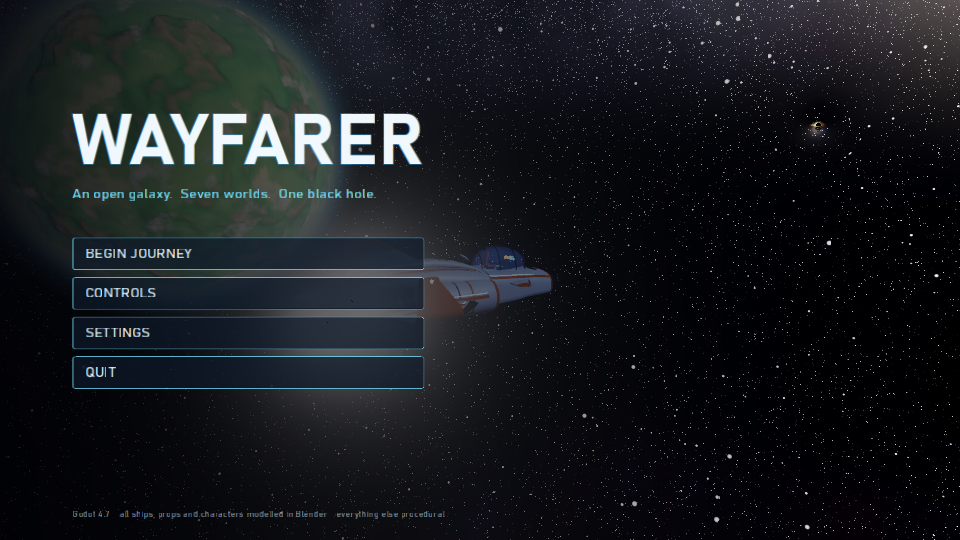<br>Main menu | 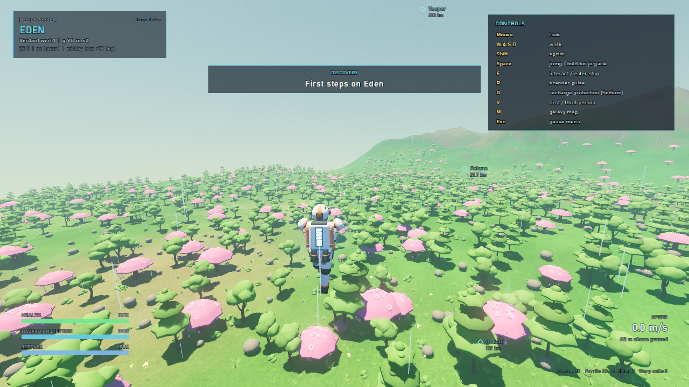<br>**Eden** (verdant): forests, meadows, pink umbrella trees |
| 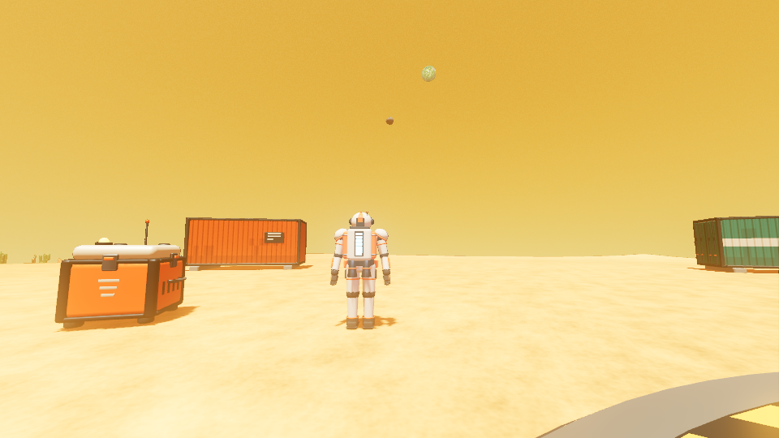<br>**Dune** (arid) at noon | 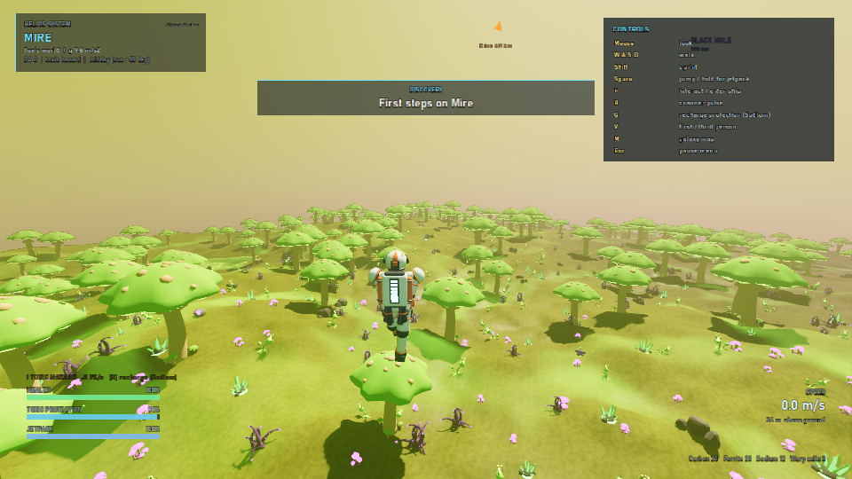<br>**Mire** (toxic): giant mushrooms, tentacle plants |
| 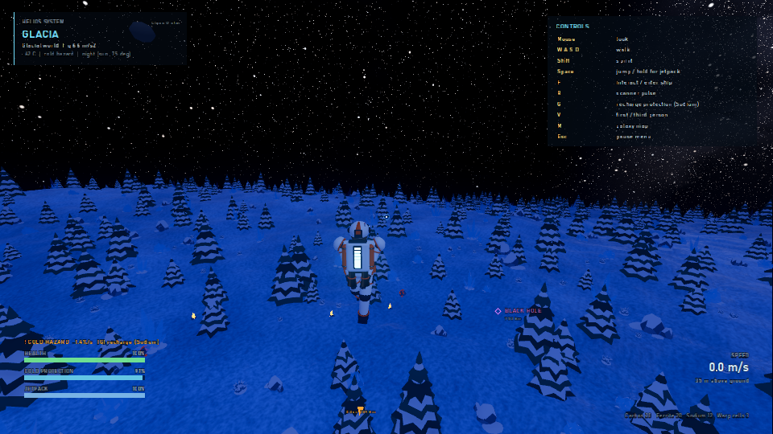<br>**Glacia** (glacial) at night | 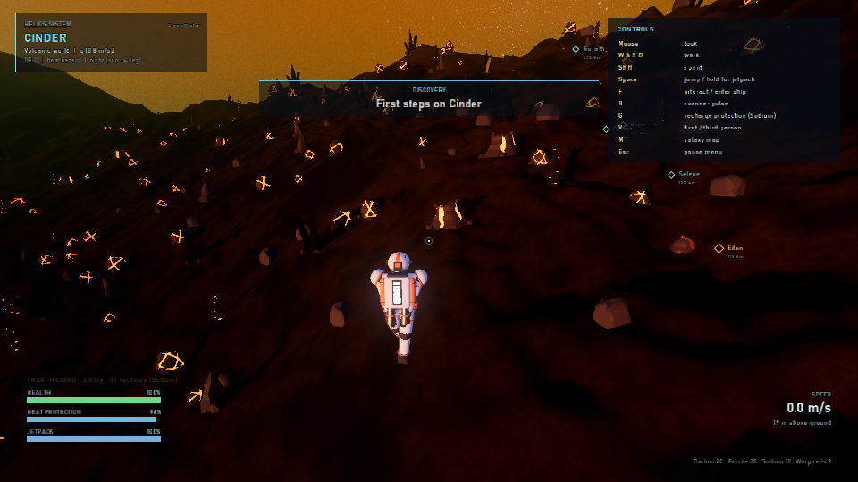<br>**Cinder** (volcanic): lava rocks and vents |
| 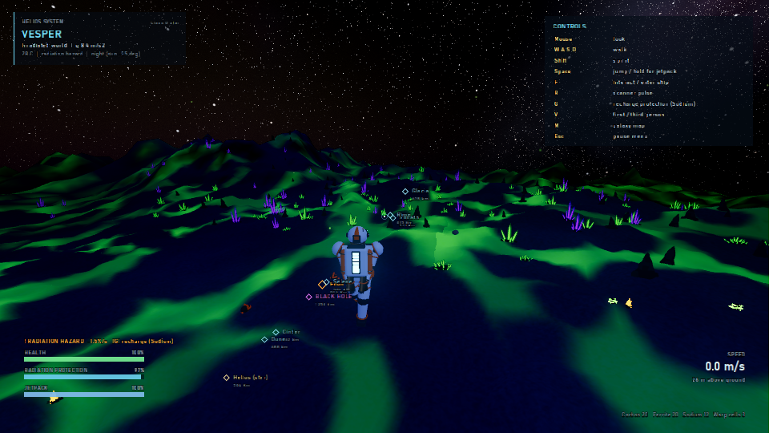<br>**Vesper** (irradiated): glowing veins and crystals | 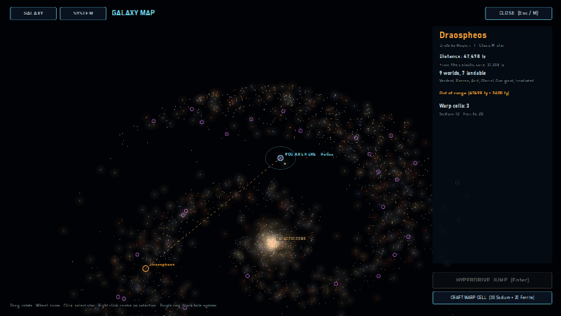<br>Galaxy map (black-hole systems have a purple ring) |
| 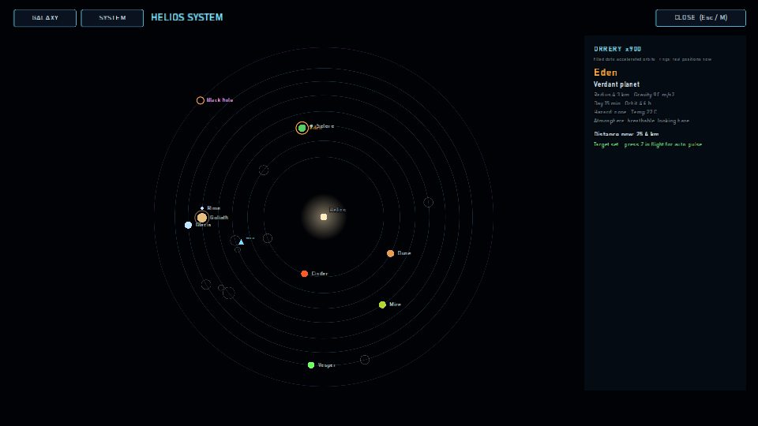<br>Helios system map | 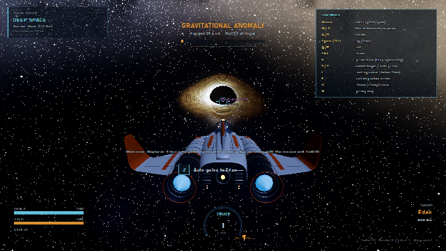<br>The black hole from 29 km: horizon, disc, lensing |
| 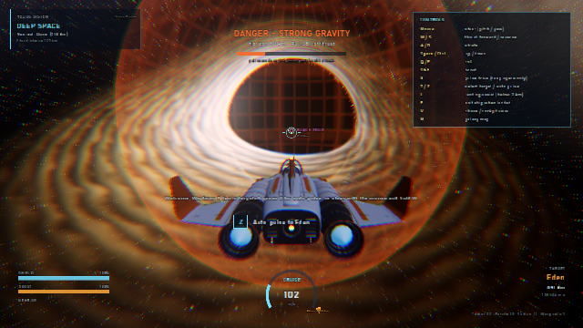<br>Danger zone (8 km): point-of-no-return shell, screen distortion | 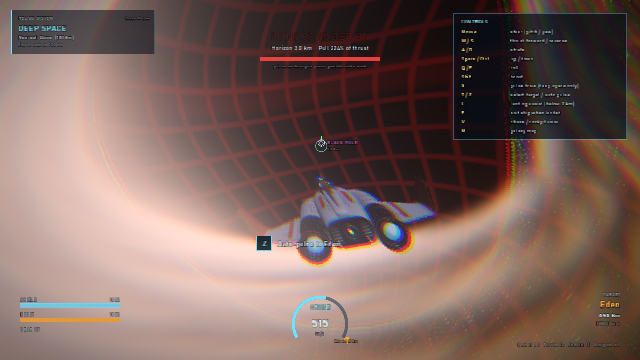<br>Past the point of no return (3 km): tidal tumble, HUD alarm |
| 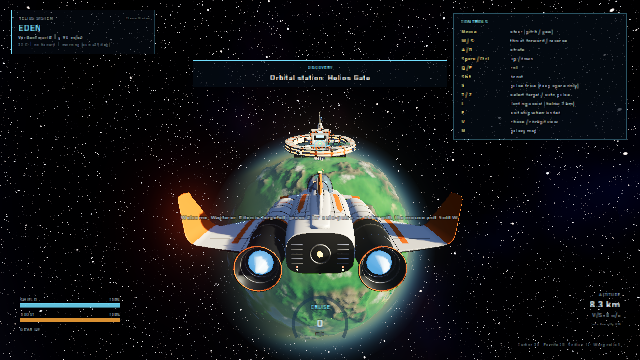<br>Station **Helios Gate** above Eden (discovery banner) | 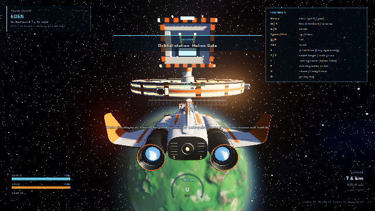<br>The rotating habitat ring and the docking arm |
| 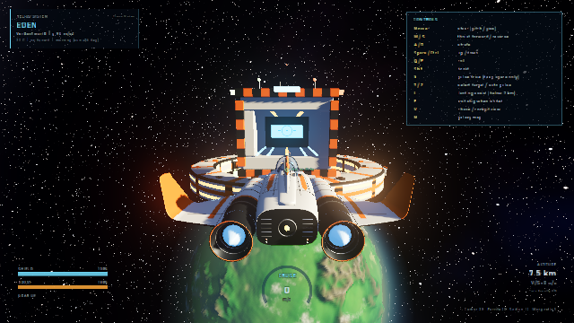<br>In front of the docking bay: flying in restores shield and boost | 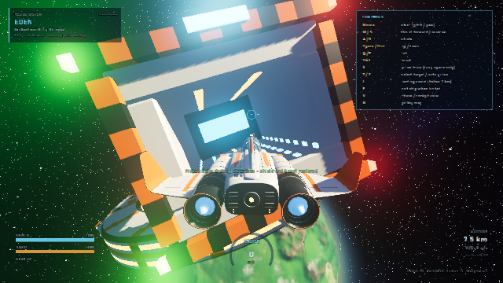<br>45 m from the bay mouth |
| 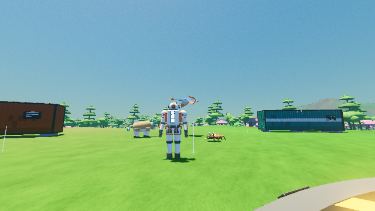<br>Eden: a grazer, a crawler and a glider next to the astronaut | 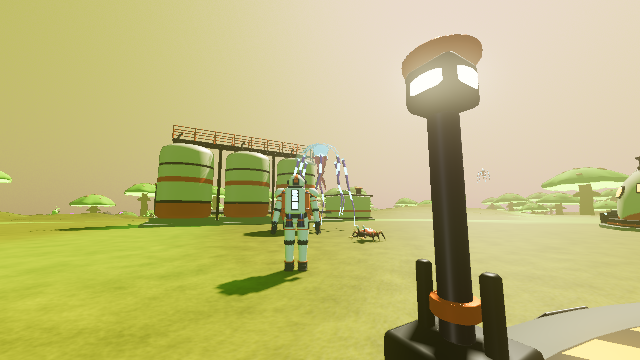<br>Mire: a floating jelly and a crawler |

---------------------------------------------------------------------------------------------------------------------------------------------------

## 1. How to run

* **Ready-made Windows build: double-click `build/Wayfarer.exe`** — one self-contained 109 MB file (the Godot 4.7.2 runtime + all game data, nothing to install). `build/Wayfarer.console.exe` is the same game with a console window that prints errors (use it if the game does not start). Needs 64-bit Windows 10/11, a Vulkan-capable GPU and a keyboard + mouse. The exe is not code-signed, so Windows SmartScreen may ask once ("More info" → "Run anyway"). The build was checked with a packaged self-test (all 65 models, the manifest and the key shaders are inside the package) and a windowed start-up run (exit code 0).
* To rebuild it yourself: Godot 4.7.2 with the Windows export templates installed, then `Godot_v4.7.2-stable_win64.exe --headless --path <project> --export-release "Windows Desktop" build\Wayfarer.exe` (the preset is `export_presets.cfg`). Start-up options after `--`: `--autostart` (skip the menu), `--autoquit=SECONDS`, `--selftest` (verify the packaged resources and quit).
* To run from the source instead: requirements Godot **4.7.2 stable** (Windows, Forward+), a Vulkan-capable GPU, keyboard + mouse; 1920×1080 or higher is recommended. Open the folder in Godot and press **F5**, or start it directly:
  `Godot_v4.7.2-stable_win64.exe --path "<local-path> 5.5 Effort Test\5. Max Effort"`
  The main scene (`res://scenes/main.tscn`) is set in `project.godot`. The first start imports the assets (a few seconds).
* The game opens on the **main menu** (a slow camera orbit around your ship in deep space). **BEGIN JOURNEY** starts at 56 km from the lush planet *Eden*, which is already targeted.
* Settings (menu → SETTINGS or pause menu): mouse sensitivity, field of view, master volume, invert Y, FPS counter and **graphics quality**
  (Low = FXAA / shorter view distance, Medium = MSAA 2x, High = MSAA 4x + SSAO; default High, Medium on the very first start of a 4K-class screen). They are stored in `user://wayfarer_settings.cfg`.

## 2. Controls

| | Key |
|---|---|
| **Ship** | |
| Steer (pitch / yaw) | mouse |
| Thrust forward / reverse | **W** / **S** |
| Strafe left / right | **A** / **D** |
| Up / down | **Space** / **Ctrl** (or **C**) |
| Roll | **Q** / **E** |
| Boost | **Shift** (uses the boost bar) |
| Pulse drive (deep space only, up to 9 km/s) | **X** |
| Cycle target / auto-pulse to the target | **T** / **Z** |
| Landing assist (below 2 km: flies to the nearest landing pad and sets down) | **L** |
| Chase / cockpit view | **V** |
| Exit the ship (when landed) / enter it again | **F** |
| **On foot** | |
| Look | mouse |
| Walk / sprint | **W A S D** / **Shift** |
| Jump / jetpack (hold) | **Space** |
| Scanner pulse (resources, outposts, wildlife) | **R** |
| Mine a resource node (hold, aim at it) | **left mouse button** |
| Recharge hazard protection (uses Sodium) | **G** |
| Interact (open crates, board the ship) | **F** |
| First / third person | **V** |
| Skip time (hold — day/night) | **Y** |
| **Everywhere** | |
| Galaxy / system map | **M** or **Tab** |
| Hyperdrive jump (map, target star selected) | **Enter** |
| Controls overview on screen | **H** or **F1** |
| Pause menu | **Esc** |
| Fullscreen on / off | **F11** (also in Settings) |

## 3. A short tour (what to try)

1. **Start** → press **Z**: the pulse drive carries you to Eden (the star, the other planets and the black hole are visible markers on the HUD; **T** cycles targets).
2. Hold **W** to cross into Eden's gravity well: the sky turns from stars into atmosphere, the hull glows with entry plasma (HUD: *ATMOSPHERIC ENTRY*), the speed limit drops.
3. **L** below 2 km → *Landing assist* flies to the nearest landing pad, lowers the gear and touches down (*Touchdown on Eden*).
4. **F** → you step out. Explore on foot: **Shift** sprint, **Space** jump, hold **Space** for the jetpack. **R** scans for resources, outposts and wildlife; hold the **left mouse button** on a glowing node to mine it; **G** recharges your hazard protection.
5. Hold **Y** to skip the day: dusk, night sky (stars, the Milky Way, neighbouring planets), dawn.
6. Walk back to the ship, **F**, lift off (**Space**) — the atmosphere thins out into space again. Every planet is a different biome: Cinder (volcanic), Dune (desert), Mire (toxic), Glacia and Rime (frozen), Vesper (irradiated), Selene (airless moon). Above Eden's northern hemisphere hangs the station *Helios Gate* (HUD marker): slide slowly into its docking bay to recharge shield and boost.
7. **M** opens the galaxy map: 2 600 stars, black-hole systems are marked with a purple ring. Select a star and press **Enter** to jump with the hyperdrive (costs 1 *warp cell*, range 3 600 ly; craft more from 30 Sodium + 20 Ferrite on the map screen).
8. Fly to the **black hole** (marker *BLACK HOLE*, 735 km from the star; the pulse drive helps) and see section 6.

## 4. What was built (feature list)

**Universe**
* Procedural galaxy (`scripts/core/galaxy.gd`): two-armed spiral + bulge, 2 600 stars (classes O…M with colour/temperature/size/brightness), 38 black-hole systems (the home system plus 37 others), every star carries a seed.
* Seed-derived systems (`system_gen.gd`): number of planets, orbits, sizes, biomes (chosen by the habitable-zone distance), moons, gas giants with rings, names, outposts — all deterministic from the star seed. The home system *Helios* is hand-tuned (9 bodies: Cinder, Dune, **Eden** + moon Selene, Mire, **Goliath** (ringed gas giant) + moon Rime, Glacia, Vesper) with a glowing star (shader sphere + corona) and a black hole.
* Kinematic orbits and spin for every body (day/night cycle on every planet, moons orbit their planets), per-planet sun direction and light level.
* Procedural sky: seeded nebula colours, star field and Milky Way band; the same functions drive the lensing around the black hole.
* Orbital points of interest (`space_props.gd`): the station **Helios Gate** above Eden (rotating habitat ring, docking bay: fly in slowly — under 45 m/s, within 90 m of the dock marker — and your shield and boost are restored), asteroid clusters, derelict satellites. Generated systems get a station above a habitable world in about half of the cases, plus satellites and asteroid clusters around gas giants. Stations show up as HUD markers.

**Planets** (details in section 5)
* Real spheres: cube-sphere quadtree terrain with continuous level of detail, worker-thread mesh generation, colliders and props only where needed.
* 7 biomes with their own terrain shape, palette, atmosphere colour, clouds, oceans / lava / acid, weather, hazards, gravity, day length, flora, resources and wildlife.
* Gravity points to the planet centre everywhere (ship and astronaut), so a planet can be circled on foot by design (the scripted tests walk tens of metres and fly a few kilometres low over the ground; nobody walked a full circumference).
* Atmosphere (ray-marched single scattering, daylight sky colour, sunsets), clouds, oceans, rings, gas giants with animated bands.
* Weather: rain, snow, ash with embers, dust storms, glowing spores (slow storm cycles, hazards get worse in storms).

**Ship and player**
* Flight model with inertial dampers, boost, pulse drive, auto-pulse to a target, planetary entry heating and speed limits, landing gear that deploys automatically, landing detection against the terrain and the landing pads, landing assist, take-off, chase and cockpit cameras, damage/shield and hazard feedback (hull stress in gas giants, stellar radiation).
* Astronaut: walk, sprint, jump, jetpack with energy, hazard protection (heat, cold, toxic, radiation), scanner, mining beam, supply crates, first / third person.
* Seamless transitions: no loading screens between space, atmosphere, surface and back.

**Interface**
* Main menu, pause menu (resume, galaxy map, controls, settings, main menu, quit), controls overview (**H**), full HUD: location panel (system, planet, biome, gravity, temperature, hazard, time of day), speed gauge, altitude / vertical speed / air density, target markers with distance and ETA, edge arrows, shield / boost / health / protection / jetpack bars, context hints ("F Exit ship"), discovery banners, scan markers, inventory strip, warnings.
* Galaxy map with 3D star view, system map, black-hole markers, hyperdrive jumps with a warp tunnel transition.
* Procedural sound (synthesised at start-up, no audio files): engines, wind, steps, jetpack, scanner, warnings, black-hole rumble, ambience.

## 5. How the planets work

**Scale.** To make interplanetary travel playable and to keep every number inside what a 32-bit GPU can represent, the system is a *pocket universe*: rocky planets and moons have radii of 0.95 – 4.9 km (gas giants 11 – 19 km, the home star 2.7 km, other stars 1.5 – 5.7 km) and orbit 90 – 870 km from their star. A planet is still big enough to have a real horizon, curvature, mountains up to several hundred metres and a day-night terminator you can walk toward. Ship speeds (cruise 420 m/s, boost 1 250 m/s, pulse drive 9 km/s) make a trip between two planets a matter of a minute.

**Precision.** All positions of bodies are kept in double precision (`d3.gd`) and the world uses a *floating origin* with two reference frames (`space_world.gd`):
* **System frame** (deep space): the viewer is always at the origin and every body is placed at `(true position − viewer position)` computed in double precision.
* **Planet frame** (near a planet, switch radius = R + max(2.2 R, 6 km), hysteresis 8 %): the planet-fixed, rotating frame with the planet centre at the origin. Terrain, colliders, outposts and the ship live in this frame, so they never move or jitter while the planet spins; velocities are converted with orbital velocity + ω × r when frames switch.
* The camera near/far planes stay within a 1:10⁷ ratio, every terrain chunk carries its centre as an instance uniform so the shader can build high-precision planet-local coordinates for the detail textures, and nothing is integrated in physics ticks (ship and astronaut are stepped in the render loop, so there is no interpolation jitter).

**Terrain.** `terrain_sphere.gd` owns a cube-sphere quadtree; each chunk is 32×32 cells with skirts, built on worker threads (`WorkerThreadPool`) from `terrain_gen.gd` (FastNoiseLite: continents, hills, ridged mountains, craters, dunes, volcano cones, terraces, lakes / seas / lava lakes depending on the biome). Split / merge distances are hysteretic, chunks are cached and recycled, far planets keep only a coarse mesh and trim their cache. When you fly fast and low the engine *prefetches* chunks along the velocity vector. Colliders (Jolt trimesh) exist only for the finest level around the player; the ship collides analytically against `height_exact()` (feet heights), which is cheaper and never tunnels.
Props (trees, rocks, crystals, resource nodes) are scattered on a fixed spatial grid so they do not change with the level of detail, then drawn through MultiMesh instances with per-planet tints; collision shapes exist only for the ones near the player.

**Atmosphere and entry.** Each planet has a shell with a ray-marched single-scattering shader (Rayleigh + Mie, planet shadow, depth clipping, aerial perspective) that works from space *and* from inside; inside the air layer it is exposure-lifted so daylight skies read blue (or orange, olive … by biome) instead of black. Air density falls with altitude and drives engine / wind sound, speed limit, heating (`heat` → plasma shader, camera shake, HUD *ATMOSPHERIC ENTRY*), cloud layers and weather. The sun dims and reddens while it sets; the ambient light follows day and night.

**Biomes** (all seven are used in the home system; every other system picks them from the star's habitable zone):

| Biome | Example | g (m/s²) | Look | Weather / hazard |
|---|---|---|---|---|
| Verdant (lush) | Eden | 8 – 11 | broadleaf & umbrella forests, meadows, oceans, cloud decks | rain · none |
| Arid (desert) | Dune | 6.5 – 9.5 | banded dunes, mesas, cacti, arches | dust storms · heat |
| Scorched (volcanic) | Cinder | 8.5 – 12 | basalt, obsidian spires, lava lakes with flowing emission | ash and embers · extreme heat |
| Glacial (frozen) | Glacia, Rime | 5.5 – 8 | snow, pines, ice crystals, frozen oceans | snow · cold |
| Toxic | Mire | 7 – 10 | bioluminescent mushrooms, acid pools, spore clouds | spores · toxic air |
| Barren (airless) | Selene | 1.8 – 3.4 | craters and regolith, black sky with the Milky Way, harsh sun | none · cold |
| Irradiated | Vesper | 7 – 10 | dark ground with glowing veins, giant crystals | spores · radiation |

Gas giants (Goliath) cannot be landed on: they have banded animated atmospheres, rings and crushing pressure if you dive in.

**Landing and take-off.** The ship has three gear legs that deploy automatically below 90 m (at less than 140 m/s) or when landing assist is active; landing is detected when a foot touches the analytic terrain or a landing pad. Gentle touchdowns settle on the legs (*Touchdown on …*); hard impacts damage the shield, and with no shield left a hull breach reboots the systems for two seconds. Landing assist (**L**) steers to the nearest landing pad of an outpost within 9 km and settles with a descent profile; without it you can land anywhere reasonably flat. Take-off is just thrust up: the ship lifts, the gear retracts, and the same smooth transition runs in reverse.

## 6. The black hole

**Where.** The home system has one (735 km from the star, `bh_rs` = 620 m Schwarzschild radius); 37 other systems of the galaxy have one too (purple ring on the galaxy map; the hole orbits just outside the outermost planet, 12 % + 70 km further out).

**Look** (`shaders/black_hole.gdshader`, `black_hole.gd`): a camera-facing billboard shader integrates light rays through a Schwarzschild field (`a = −1.5 h² r / |r|⁵` in units of r_s) for every pixel. This gives a black event horizon, a thin glowing accretion disc (3 – 14 r_s) with a temperature gradient and relativistic Doppler beaming (one side is brighter), the *secondary image* of the disc bent over and under the hole, a thin photon ring, and gravitational lensing of the real sky behind it (stars and the Milky Way bend and smear around the shadow). A faint red/orange *point-of-no-return shell* appears when you get close.

**Mechanics** (all numbers in `black_hole.gd`) — designed around one idea: *the pull is a physical 1/d² force; the point of no return is the distance where it equals the ship's boosted engine power*, so the player can read it from the HUD and make a decision.
The pull on the ship is `K / d²` with `K = 6.35·10⁹ m³/s²` (capped at 5 200 m/s²); `d` is the distance to the centre. The HUD always shows the pull as a percentage of the ship's *boosted* thrust (78 m/s² × 2.7 = 210 m/s²).
1. **Gravitational anomaly** (< 140 km, pull 0.3 m/s²): the HUD shows *GRAVITATIONAL ANOMALY* with the distance to the horizon and the pull as % of thrust; a deep rumble fades in (louder the closer you get); from ~70 km the glow of the disc starts to light the ship, and within ~43 km (70 r_s) the sky around the hole is visibly lensed.
2. **Danger** (< 26 km, pull ≈ 9 m/s², ~4 % of thrust): *DANGER – STRONG GRAVITY* (orange), camera shake grows with the pull, the thrust-margin bar fills (the white mark = pull equals full engine power).
3. **Losing authority** (≈ 9 km, pull > 35 % of thrust): the pull starts to override your steering and thrust — control authority drops continuously (up to −88 %) as the pull approaches and passes the engine power. From 14 km a screen effect pulls the picture toward the centre, twists, darkens and reddens it (full strength ~2 km from the horizon).
4. **Point of no return** (≈ 5.5 km = 9 r_s, where the pull equals the boosted thrust): inside 6.5 km the HUD turns red and flashes *POINT OF NO RETURN*, the alarm sounds and the red-orange shell around the hole pulses. Beyond this line not even a full boost can climb out any more.
5. **Time and tides** (< 4.3 km = 7 r_s): local time slows down to 38 % at the horizon; below 3.3 km tidal forces stretch the ship, drag its nose toward the hole and make the hull tumble while the disc fills the screen.
6. **Capture** (< 1.02 r_s): white flash and a warp tunnel transition, then you reappear in the **destination system** — the star closest to the point 7 000 ly *toward the galactic core* ("black holes are one-way shortcuts to the dense centre of the galaxy"). There is no way back through the hole; the hyperdrive and the galaxy map take you wherever you want afterwards. Your inventory is kept; the statistics count the jump.
Why this design: it uses only the information a pilot already has (a thrust bar, a distance), it creates tension (you can stay at a safe distance and admire the disc, or deliberately cross the line), the outcome is a big, clear, rewarding event (a new system of the galaxy) rather than a "game over", and the one-way jump toward the core gives the galaxy map a direction to explore.

## 7. 3D models (Blender MCP)

All models were built with Blender operations/scripts through the MCP socket on **port 9881** in `max_effort.blend` (no downloaded assets, no asset-generation integrations) and exported with `blender/export_*.py` to `assets/models/*.glb` (+ `manifest.json` with collision hints and sizes). Scripts for every model are in `blender/` (`model_*.py`, shared helpers in `lib.py` / `lib_nature.py`), the rules in `blender/CONVENTIONS.md`, per-model triangle counts and sizes in `blender/PROGRESS.md`.
Materials follow a *name contract*: `Foliage_*`, `Crystal_Main`, `Glow_Main`, `Rock_*`, `Bark` are recoloured by the game per planet (so one tree model gives green, pink, cyan or orange forests); `Obsidian`, `Glow_Lava`, `Snow`, `Res_*`, `Emissive_*`, `Glass*` keep their colours.

<!-- MODELS -->
| Model (`assets/models/<name>.glb`) | Triangles | Size W x H x D (m) |
|---|---|---|
| **Player ship and character** | | |
| `ship_explorer` | 28 150 | 12.9 x 6.2 x 14.2 |
| `astronaut` | 20 848 | 1.05 x 1.8 x 0.60 |
| **Outposts, landing pad and points of interest** | | |
| `landing_pad` | 7 725 | 16.0 x 3.35 x 16.0 |
| `outpost_hab` | 7 462 | 9.3 x 7.75 x 9.9 |
| `outpost_tower` | 6 732 | 8.8 x 18.9 x 5.1 |
| `outpost_container` | 5 808 | 6.1 x 3.55 x 2.8 |
| `outpost_container_b` | 7 756 | 9.1 x 3.55 x 2.8 |
| `outpost_tank` | 7 752 | 21.8 x 8.7 x 6.5 |
| `outpost_solar` | 6 684 | 12.1 x 4.0 x 5.4 |
| `beacon_pylon` | 1 704 | 2.7 x 7.9 x 2.7 |
| `monolith` | 5 190 | 8.6 x 7.8 x 8.7 |
| `crate_supply` | 2 684 | 1.5 x 1.7 x 1.35 |
| `wreck_ship` | 6 836 | 6.3 x 4.6 x 10.3 |
| `probe_wreck` | 2 496 | 5.9 x 3.7 x 3.5 |
| **Verdant flora** | | |
| `tree_lush_a` | 2 016 | 6.9 x 9.1 x 6.0 |
| `tree_lush_b` | 1 801 | 7.0 x 14.4 x 7.4 |
| `tree_lush_c` | 2 100 | 10.3 x 7.6 x 10.1 |
| `bush_lush` | 545 | 1.9 x 1.5 x 2.0 |
| `fern` | 431 | 2.0 x 1.2 x 2.2 |
| `flower_cluster` | 360 | 0.8 x 0.7 x 0.7 |
| `grass_tuft` | 55 | 1.0 x 0.7 x 1.3 |
| **Arid flora and rock formations** | | |
| `cactus_a` | 1 080 | 2.2 x 4.8 x 1.3 |
| `cactus_b` | 803 | 1.8 x 1.3 x 1.7 |
| `dead_tree` | 1 036 | 2.7 x 5.4 x 1.3 |
| `desert_shrub` | 310 | 1.5 x 1.0 x 1.5 |
| `mesa_rock` | 524 | 9.5 x 9.4 x 8.8 |
| `rock_arch` | 624 | 13.1 x 10.2 x 4.6 |
| **Glacial flora and ice** | | |
| `tree_pine_snow` | 1 514 | 7.3 x 10.5 x 5.9 |
| `tree_pine_snow_b` | 1 177 | 5.1 x 6.5 x 4.6 |
| `ice_spire` | 480 | 3.1 x 5.3 x 3.2 |
| `ice_boulder` | 312 | 3.2 x 2.1 x 2.6 |
| `frost_shrub` | 415 | 1.6 x 1.1 x 1.8 |
| `snow_rock` | 255 | 3.7 x 2.3 x 3.4 |
| **Scorched (volcanic)** | | |
| `obsidian_spire` | 326 | 3.7 x 6.4 x 3.5 |
| `lava_rock` | 494 | 3.3 x 2.2 x 2.6 |
| `charred_tree` | 804 | 1.8 x 4.9 x 2.2 |
| `vent_cone` | 780 | 5.9 x 3.2 x 5.6 |
| **Toxic swamp** | | |
| `mushroom_giant` | 1 972 | 10.9 x 12.1 x 10.9 |
| `mushroom_small` | 740 | 1.4 x 1.2 x 1.1 |
| `spore_pod` | 709 | 2.4 x 2.5 x 1.6 |
| `tentacle_plant` | 1 324 | 3.0 x 2.6 x 3.2 |
| `toxic_crystal` | 420 | 1.8 x 2.1 x 1.8 |
| **Irradiated** | | |
| `crystal_cluster_a` | 405 | 2.4 x 3.2 x 2.5 |
| `crystal_cluster_b` | 664 | 2.8 x 1.3 x 2.4 |
| `crystal_cluster_c` | 359 | 2.4 x 4.7 x 2.6 |
| `rad_fungus` | 572 | 1.2 x 0.9 x 1.1 |
| **Rocks (every biome) and moon rocks** | | |
| `rock_a` | 320 | 2.1 x 1.8 x 1.9 |
| `rock_b` | 104 | 2.7 x 1.6 x 2.4 |
| `rock_c` | 426 | 3.3 x 1.6 x 2.9 |
| `rock_d` | 157 | 2.7 x 3.6 x 2.3 |
| `boulder_big` | 439 | 8.8 x 6.1 x 7.0 |
| `moon_rock_a` | 182 | 2.6 x 1.5 x 1.9 |
| `moon_rock_b` | 76 | 2.9 x 1.6 x 2.7 |
| **Resource nodes** | | |
| `resource_sodium` | 237 | 1.2 x 1.4 x 1.1 |
| `resource_ferrite` | 688 | 1.8 x 1.3 x 1.4 |
| `resource_carbon` | 590 | 2.1 x 1.3 x 2.0 |
| **Wildlife** | | |
| `creature_grazer` | 2 336 | 1.0 x 1.5 x 2.4 |
| `creature_flyer` | 1 314 | 2.7 x 0.6 x 2.9 |
| `creature_floater` | 2 166 | 3.4 x 5.4 x 3.4 |
| `creature_crawler` | 1 960 | 1.0 x 0.5 x 1.2 |
| **Space objects** | | |
| `space_station` | 15 280 | 153.6 x 120.9 x 184.7 |
| `asteroid_a` | 1 050 | 33.4 x 15.3 x 17.4 |
| `asteroid_b` | 1 050 | 29.4 x 28.7 x 30.3 |
| `asteroid_c` | 1 048 | 32.3 x 22.1 x 20.8 |
| `satellite` | 1 782 | 9.5 x 7.0 x 4.8 |

**65 models, 174 439 triangles in total**, all modelled in Blender through the MCP socket (port 9881).
<!-- /MODELS -->

## 8. Project layout

```
project.godot            main scene scenes/main.tscn, autoload Game, Jolt physics
scenes/main.tscn         root scene: scripts/main.gd builds the world, player, HUD, menus, map
scripts/core/            util, d3 (double vectors), biomes, galaxy, system_gen, body/system data, models (GLB loader), game (settings, input map, inventory)
scripts/world/           space_world (frames, orbits, lights), terrain_gen, terrain_sphere, planet, star, black_hole, outposts, fauna
scripts/ship/ player/    ship.gd (flight, landing, entry), astronaut.gd, player_controller.gd (actor switching, mining, scanning)
scripts/ui/              hud, menus, galaxy_map, screen_fx, ui_kit
scripts/fx/              space_dust, weather_fx, procedural sound (sfx_synth / sfx_manager)
shaders/                 terrain, atmosphere, sky, star, corona, clouds, ocean, gas_giant, ring, black_hole, pnr_shell, plasma, flame, dust, screen_fx
assets/models/           glb exports + manifest.json
blender/                 modelling scripts, briefs, conventions, progress notes
tools/                   automated test scenes (test_*.tscn), run_godot.ps1 + gd_hidden.ps1 (private-desktop, memory-capped runner), regress.ps1 (headless suite), guarded_run.ps1 (supervised single run),
                         bl.py (Blender MCP client), glb_info.py, make_model_table.py, sum_tokens.py + make_results.py (token / cost report)
docs/screenshots/        gallery images used by this README
build/                   ready-made Windows build: Wayfarer.exe (single file), Wayfarer.console.exe, README.txt
export_presets.cfg       the export preset "Windows Desktop" (embedded package, icon, product info)
.timing/                 start time and the log of interruptions used for RESULTS.md
```

## 9. Testing

The game was tested end to end with scripted scenes in `tools/` that drive the real main scene and print state and script errors (screenshots are saved by the windowed variants):
* `test_game` = start → fly → atmospheric entry → landing assist → touchdown → exit → scan → walk → time skip → back in the ship → take-off; `test_bh` = black hole approach through all zones, capture and transport; `test_warp` = galaxy map + hyperdrive jump; `test_menu` = menu, controls, settings, HUD, pause, maps.
* `test_smoke` loads a dozen generated systems (planets, orbital props, black-hole systems) and prints memory use; `test_soak` visits all eight landable worlds on foot, sweeps the day on each and flies fast and low for a minute — it must stay in the few-hundred-MB range (it peaks at ~330 MB).
* `test_biomes`, `test_sky`, `test_final` take screenshots of the biomes, noon / dusk skies, the station, the wildlife and the black hole.
`test_game`, `test_bh`, `test_smoke`, `test_soak`, `test_final` also run **headless** (no GPU at all); `tools/regress.ps1` chains import → smoke → soak → game → black hole → final (dry run). Everything must be started through `tools/run_godot.ps1`, which puts the Godot process on a private Windows desktop (no window ever appears on the user's screen), caps its frame rate (30 fps) and its committed memory (6 GB job object) and lowers its CPU priority.

Status of the last runs (every completed run printed **0 script errors**): in the final headless regression import, smoke, soak and game passed (all 65 models imported); its black-hole and dry-run steps were cut off when the test PC froze (see RESULTS.md), but both had passed in earlier headless runs (black hole 15:43, final dry run 15:45). Afterwards the station, the docking-bay logic, the wildlife and the black hole were checked in three **supervised tiny windowed runs** (	ools/guarded_run.ps1: 640×360, 12 fps, memory-capped, a watchdog that stops the run on high GPU temperature / utilisation or low memory; the GPU stayed below 8 % and 42 °C, the process below 1.6 GB) whose frames are in the gallery above. Windowed screenshot runs were also completed for the menu / HUD / maps, every biome (Eden, Dune, Mire, Glacia, Cinder, Vesper) and the skies.

## 10. Known limitations and decisions

* Scale is deliberately small (see section 5); orbital mechanics are kinematic (planets follow Kepler-like circular orbits, not n-body).
* Gas giants are not landable; there is no swimming (water is a visual surface over a walkable sea floor).
* Wildlife is ambient (scannable, flees or hovers); there is no combat, no base building, no trading.
* No save game (only settings are stored); every launch starts at the same place.
* Sound is synthesised in code at start-up (no audio files). It could not be listened to in the automated test setup (dummy audio driver), so it was only verified to run without errors — levels may need tuning by ear (master volume is in Settings).
* **Only seen in tiny test frames:** the station *Helios Gate*, the four creatures and the black-hole shell were looked at in 640×360 frames (and the creatures only as posed, static models - their walking / flapping animation was not watched). If something looks off, tune: the station scale in system_gen.gd / space_props.gd, creature sizes and gaits in auna.gd, the shell strength in shaders/pnr_shell.gdshader.
* Streaming: at boost speed very close to the ground, distant props can pop in; colliders only exist for the finest terrain level.
* Performance target: 60+ fps at 1080p on a recent GPU in *High*; use *Medium* or *Low* in Settings for weaker hardware.
* Time of day on every planet follows the spin of that planet (hold **Y** to skip), so the first planet you visit may be in night.
